# Microduck RL บน Newton — หลักสูตร 12 สัปดาห์

ต่อยอดจาก [pollen-robotics/microduck_rl](https://github.com/pollen-robotics/microduck_rl) (mjlab / MuJoCo-Warp) โดยย้ายเป็ดไปรันและเทรนบน **[Newton](https://github.com/newton-physics/newton) 1.17** ผ่าน Isaac Lab — ทั้งหมดทดสอบบน GPU 6 GB (RTX 3060 Laptop)
README เดิมของ Pollen อยู่ที่ [`README.pollen.md`](README.pollen.md) · วิดีโอและ policy ทั้งหมดอยู่ใน [release `course-v1`](https://github.com/pannatron/microduck_rl/releases/tag/course-v1)

[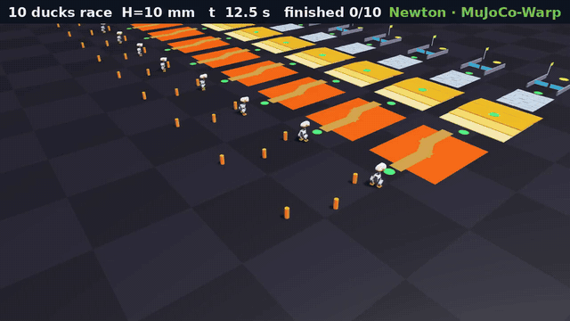](https://github.com/pannatron/microduck_rl/releases/download/course-v1/adv-newton-race-10-lanes.mp4)

*Duck Adventure บน Newton: 10 เลน 5 policy วิ่งด่านเดียวกันพร้อมกันบน GPU เดียว (คลิกเพื่อดู mp4 เต็ม)*

## สิ่งที่ทำใหม่บน Newton

| งาน | ไฟล์ | ผลที่วัดได้ |
|---|---|---|
| รัน policy เป็ดหลายพันตัวพร้อมกัน | [`newton_port/newton_duck.py`](newton_port/newton_duck.py) | 1,024 ตัว ~4,000× เวลาจริง · CUDA graph |
| เทรนบน Newton (Isaac Lab task) | [`newton_port/isaaclab_task/`](newton_port/isaaclab_task) | 4,096 env 0.74 s/it 1.4 GB (mjlab 3.0 s/it 5 GB) · 16,384 env 176k step/s |
| Latency DR บน Newton | `LATENCY_DR=1` ใน `microduck_tasks.py` | หน่วงเต็ม: ตัวเดิมล้ม 684/1,024 → ตัวมี DR ล้ม 0 |
| ท่าใหม่: หันหัวตามเป้าขณะเดิน | `Microduck-HeadTrack-Flat-Newton` | yaw error 1.4° (v1) / 1.2° (v2) |
| **Duck Adventure** ด่านตะลุย 5 โซน หลายเลนบน GPU | [`newton_port/newton_adventure.py`](newton_port/newton_adventure.py) | 10 เลน × 180 s ใน 56 s · ประตูบานพับจริงในฟิสิกส์ |
| เทียบ sim-to-sim: MuJoCo CPU · MuJoCo-Warp · Newton | `newton_duck.py --pd-kd --sensor-lag --act-delay` | kd ของ PD ต่างกันทำความเร็วต่าง 35% |

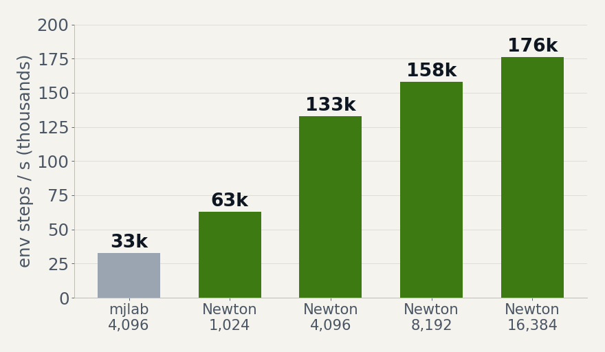

## วิดีโอ (Newton ViewerGL)

| | |
|---|---|
| [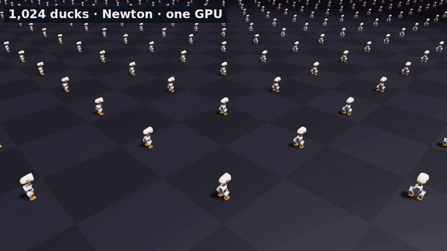](https://github.com/pannatron/microduck_rl/releases/download/course-v1/m6-newton-crowd-1024.mp4)<br>**เป็ด 1,024 ตัวบน GPU เดียว** · `newton_duck.py --video` | [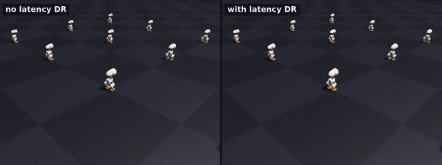](https://github.com/pannatron/microduck_rl/releases/download/course-v1/m6-latency-dr-compare.mp4)<br>**Latency DR** · ซ้าย: ไม่มี DR ล้มเมื่อหน่วงเต็ม · ขวา: มี DR เดินต่อได้ |
| [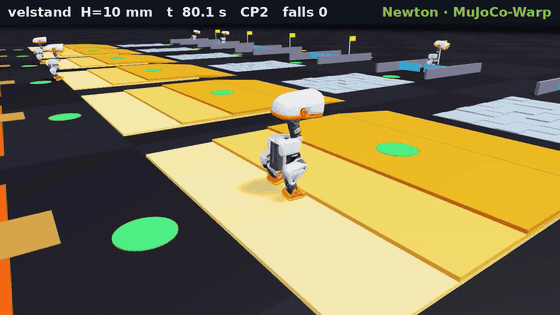](https://github.com/pannatron/microduck_rl/releases/download/course-v1/adv-newton-velstand-10mm.mp4)<br>**velstand เข้าเส้นชัย** ด่าน 10 mm · กล้องตาม `--cam follow:4` | [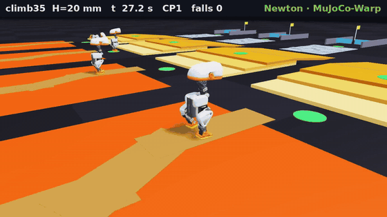](https://github.com/pannatron/microduck_rl/releases/download/course-v1/adv-newton-climb35-20mm.mp4)<br>**climb35 ล้มที่บันได 20 mm** · ยกเท้าได้แค่ ~1 ซม. |
| [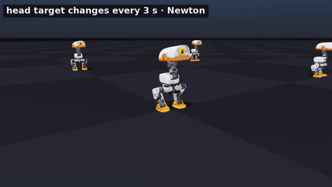](https://github.com/pannatron/microduck_rl/releases/download/course-v1/w8-head-tracking.mp4)<br>**หันหัวตามเป้าขณะเดิน** · policy ท่าใหม่ที่เทรนบน Newton | [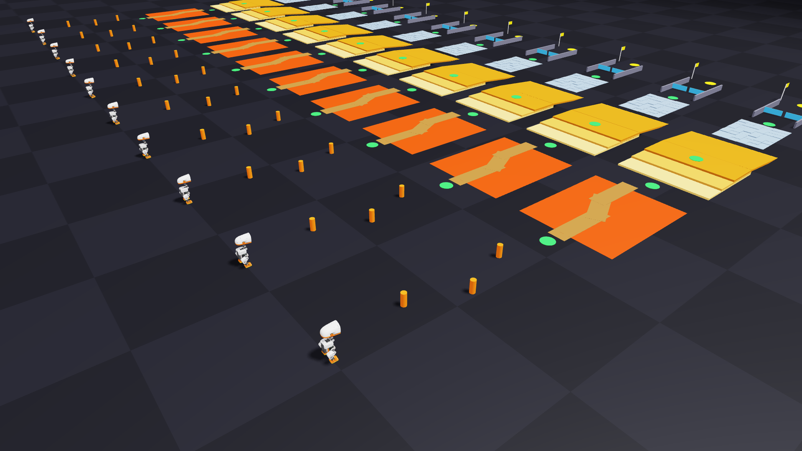](https://github.com/pannatron/microduck_rl/releases/download/course-v1/adv-newton-race-10-lanes.mp4)<br>**ด่าน 10 ชุด = 10 world** · `scene.replicate()` |

วิดีโอเต็มทุกคลิป (รวมฝั่ง MuJoCo ไว้เทียบ) อยู่ใน [release `course-v1`](https://github.com/pannatron/microduck_rl/releases/tag/course-v1)

## งานประยุกต์บน Newton

| | |
|---|---|
| [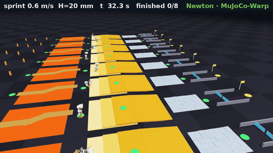](https://github.com/pannatron/microduck_rl/releases/download/course-v1/app-sprint-20mm.mp4)<br>**แก้ด่านโดยไม่เทรนใหม่** · สั่ง 0.6 m/s เฉพาะช่วงบันได → ข้าม 20 mm ได้ 22/64 เลน (จาก 6/64) | [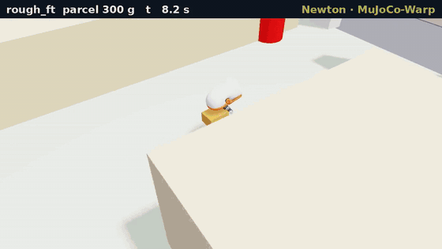](https://github.com/pannatron/microduck_rl/releases/download/course-v1/app-delivery-rough_ft-300g.mp4)<br>**ส่งพัสดุในอพาร์ตเมนต์ของ Pollen** · [`newton_delivery.py`](newton_port/newton_delivery.py) · พัสดุ 0–400 g × 3 เส้นทาง |
| [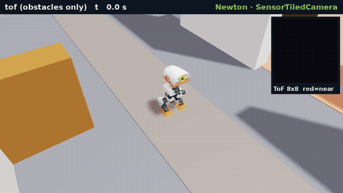](https://github.com/pannatron/microduck_rl/releases/download/course-v1/app-tof-falls-into-stairwell.mp4)<br>**ToF 8×8 ของเป็ดจริงบน Newton** · ดูแค่สิ่งกีดขวาง → ตกช่องบันได | [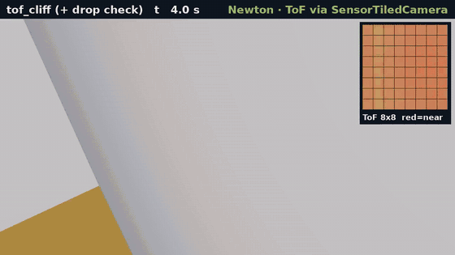](https://github.com/pannatron/microduck_rl/releases/download/course-v1/app-tof-cliff-check.mp4)<br>**+ ตรวจพื้น (cliff)** · [`newton_tof.py`](newton_port/newton_tof.py) · ล้มจาก 7/8 เหลือ 1/8 |

| งาน | ผลวัด |
|---|---|
| ส่งพัสดุ ≤ 200 g | `newton_walk_2000` ส่งครบ 12/12 ใน 15–20 s · 300 g ส่งได้ 4/12 |
| ส่งพัสดุ 300–400 g | มีแค่ `rough_ft` ที่ส่งครบ 12/12 (~47 s) |
| ToF: เดินไม่รู้ตำแหน่ง 180 s | blind ล้ม 15/16 · ToF ล้ม 12/16 (ตกช่องบันได 8) · ToF + cliff ล้ม 4/16 |

ToF ใช้ `newton.sensors.SensorTiledCamera` เป็นกล้อง depth 8×8 มุม 45° วางที่ site `tof` บนหัวเป็ด + noise ตาม [`sim/tof.py`](src/mjlab_microduck/sim/tof.py) ของ Pollen — เรนเดอร์ทุก world ในครั้งเดียว

## เริ่มรัน

```bash
# 1) repo นี้ (โค้ด Pollen + งานหลักสูตร) — ต้องมี uv
git clone git@github.com:pannatron/microduck_rl.git ~/repos/microduck_rl
cd ~/repos/microduck_rl && uv sync

# 2) policy + npz จาก release
gh release download course-v1 -R pannatron/microduck_rl -p "*.onnx" -D exports
gh release download course-v1 -R pannatron/microduck_rl -p "*.npz"  -D newton_port

# 3) Newton อยู่ใน venv ของ Isaac Lab (~/IsaacLab, backend Newton ไม่ต้องมี Isaac Sim)
cd ~/IsaacLab
.venv/bin/python ~/repos/microduck_rl/newton_port/newton_duck.py --policy newton_walk_2000 --cmds 0.2,0.3,0.4 --per-cmd 16 --pd-kd 0.053
.venv/bin/python ~/repos/microduck_rl/newton_port/newton_adventure.py --level adv10 \
    --policies walk_2000,rough_ft,newton_walk_2000 --per 2 --video /tmp/frames --cam overview

# 4) เทรนบน Newton
uv run python ~/repos/microduck_rl/newton_port/isaaclab_task/train.py \
    --task Microduck-Walk-Flat-Newton --num_envs 4096 physics=newton_mjwarp
```

path ในสคริปต์ยังอ้าง `~/repos/microduck_rl` และ `~/IsaacLab` ตรง ๆ — clone ไว้ที่เดียวกันก่อน

## Duck Adventure

ด่านเขียนเป็น MJCF ([`playground/make_adventure.py`](playground/make_adventure.py)) แล้ว `newton_adventure.py` อ่าน geom ทุกชิ้นมาสร้างใน Newton ModelBuilder — ด่านไฟล์เดียวใช้ได้ทั้ง Newton และ MuJoCo CPU
แต่ละเลนเป็น world แยก กติกาเกม (checkpoint, ล้ม/ตกลาวา → เกิดใหม่) และ autopilot คำนวณเป็น tensor บน GPU

| policy | Newton ด่าน 10 mm (4 เลน) | MuJoCo CPU + BAM ด่าน 10 mm |
|---|---|---|
| velstand (Pollen) | เข้าเส้น 4/4 · 111–140 s | ค้างหน้าบันไดขั้นที่ 2 |
| rough_ft | ถึง CP4 ล้มที่ประตู | เข้าเส้น 128 s |
| newton_walk_2000 (เทรนบน Newton) | ถึง CP4 ล้ม 62–70 ครั้ง | — |
| climb35 (บันได ≤ 3.5 cm) | ติดที่ภูเขา | เข้าเส้น 130 s |

บันได 20 mm ไม่มีใครผ่านบน Newton — `climb35` ยกเท้าได้แค่ ~1.06 cm ตลอดการเทรน

## Gotchas ของ Newton ที่เจอจริง

- `SolverMuJoCo` เท่านั้นที่เสถียร — Featherstone / XPBD / semi-implicit ได้ NaN กับเป็ด (contact kd 100 แข็งเกิน)
- `njmax` / `nconmax` ของ `SolverMuJoCo` เป็นค่า **ต่อ world** — คูณจำนวน world เองแล้วจะ OOM
- `body_qd` = `[lin, ang]` ใน world frame · `mj_step` คำนวณ sensor ก่อน integrate → gyro ช้า 1 substep (`--sensor-lag 1`)
- PD ใน Isaac Lab มี kd 0.053 แต่ position actuator ใน MJCF มี kv 0 → ต้องใส่ `--pd-kd 0.053` ไม่งั้นเป็ดช้าลงและล้ม
- body ที่มี joint ต้องใช้ `add_link()` ไม่ใช่ `add_body()` (แถม free joint) · `joint_target_q` เป็น layout แบบ coord
- `ViewerGL` เลื่อน world ไปวางเป็นตารางเอง → `viewer.set_world_offsets((0, 0, 0))` เมื่อฟิสิกส์จัดวางเองแล้ว
- `SolverMuJoCo` บังคับให้ทุก world มี shape เท่ากัน — เลนที่ไม่มีพัสดุก็ต้องมีกล่องซ่อนไว้
- body จาก MJCF ล็อก inertia → `add_shape_*` ไม่เพิ่มมวล ต้องแก้ `body_mass` / `body_com` / `body_inertia` เอง

## โครง repo

| ที่ | อะไร |
|---|---|
| `newton_port/` | ทุกอย่างที่เป็น Newton: ตัวรัน, Duck Adventure, ส่งพัสดุ (`newton_delivery.py`), ToF (`newton_tof.py`), Isaac Lab task, แปลง ONNX ↔ npz |
| `playground/` | ฝั่ง MuJoCo CPU: แอปควบคุม (`ctl_*.py`), ด่าน, `sim_play.py` (`--live` = เล่นเองด้วยคีย์บอร์ด), system ID มอเตอร์ |
| `course/` | README หลักสูตร + ตัวสร้างสไลด์และผลวัด (`course/slides/results*.json`) |
| `src/`, `scripts/` | โค้ดเดิมของ Pollen — แก้บรรทัดเดียว: env `MICRODUCK_STAIR_MAX` ใน `microduck_velocity_env_cfg.py` |

อัปเดตโค้ดจาก Pollen: `git remote add upstream https://github.com/pollen-robotics/microduck_rl.git && git fetch upstream && git merge upstream/develop`

## License

โค้ดเป็น Apache-2.0 ตาม repo ต้นทาง ([`LICENSE`](LICENSE)) · ไฟล์โมเดล 3D เป็นของ Pollen Robotics ดู [`LICENSE-MODELS.md`](LICENSE-MODELS.md)
